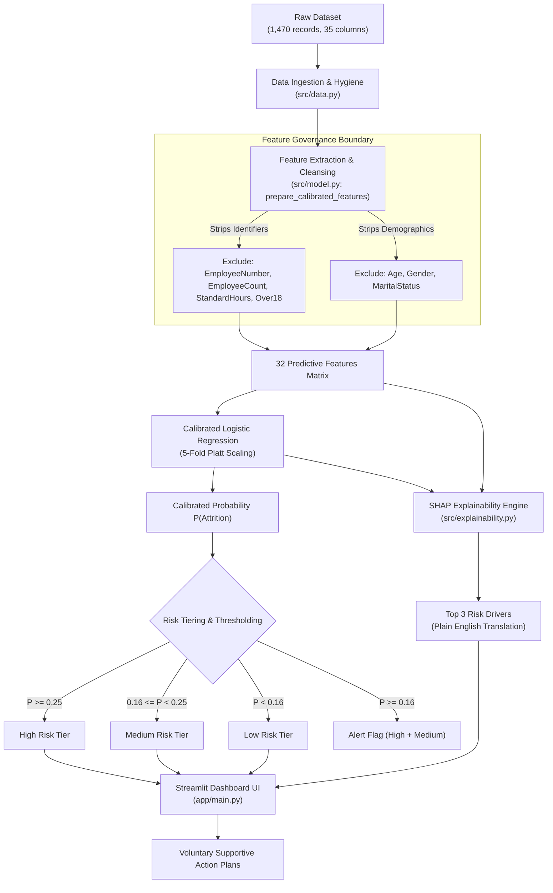

# RetainIQ – Responsible Employee Attrition & Retention Intelligence Platform

> **Status:** Educational Prototype | **Version:** 1.0.0 (Day 6 Final Release)  
> **Primary Model:** Calibrated Age-Excluded Logistic Regression (`models/calibrated_model_day2_age_excluded.pkl`)  
> **Evaluation Holdout:** IBM HR Employee Attrition Benchmark ($N=294$, 47 positive attrition events)

RetainIQ is an AI-powered workforce retention intelligence dashboard designed for **HR business partners, department heads, and people managers**. It bridges the gap between predictive machine learning and ethical HR decision-making by converting historical workforce data into calibrated flight-risk probabilities, transparent feature attribution, and voluntary, supportive retention interventions.

---

## Table of Contents

- [1. Project Overview & Problem Statement](#1-project-overview--problem-statement)
- [2. Dashboard Features & Core Pages](#2-dashboard-features--core-pages)
- [3. System Architecture & Prediction Workflow](#3-system-architecture--prediction-workflow)
- [4. Dataset Description & Limitations](#4-dataset-description--limitations)
- [5. Model Selection & Governance Rationale](#5-model-selection--governance-rationale)
- [6. Evaluation Metrics & Fairness Audit](#6-evaluation-metrics--fairness-audit)
- [7. Responsible AI & Operational Restrictions](#7-responsible-ai--operational-restrictions)
- [8. Installation & Launch Instructions](#8-installation--launch-instructions)
- [9. Automated Testing & Verification](#9-automated-testing--verification)
- [10. Project Directory Structure](#10-project-directory-structure)

---

## 1. Project Overview & Problem Statement

Unplanned employee turnover creates substantial organizational disruption, including institutional knowledge loss, lowered team morale, and significant replacement expenses (historically modeled around 1.5× base salary). Traditional HR reporting relies almost entirely on lagging exit interviews after resignation letters are tendered.

RetainIQ provides a **proactive, human-centered early alert system**:
- Estimates flight probabilities using a calibrated, demographic-blind linear model.
- Dissects risk drivers into plain-English organizational factors (e.g., overtime hours, promotion stagnation, stock options).
- Suggests **exclusively voluntary, supportive interventions** to retain talent while strictly forbidding punitive or automated adverse actions.

---

## 2. Dashboard Features & Core Pages

The RetainIQ user interface is implemented in Streamlit with a clean, high-contrast Navy Light theme (`#1b365d` primary accent, `#ffffff` card surfaces, and `#f8fafc` canvas background).

```
+---------------------------------------------------------------------------------------+
|  RetainIQ Navigation: [ Overview ]  [ Employee Directory ]  [ Risk Analysis ]  [ Insights ]  |
+---------------------------------------------------------------------------------------+
```

### Page 1: Overview
- **Executive KPI Cards** (default view, current employees only): Evaluated Workforce (1,233 current employees), Historical Turnover Rate (16.1%, computed over all 1,470 records), High Flight Risk Headcount (173), and Total Illustrative Cost Exposure ($16.1M based on the 1.5× replacement assumption). Switching off **Current employees only** in the sidebar adds back the 237 past leavers (1,470 records, 323 high risk, $26.8M).
- **Departmental Risk Distribution**: Visual comparison of low, medium, and high-risk proportions across R&D, Sales, and Human Resources.
- **Overtime Exposure Contrast**: Highlights the severe divergence between overtime staff (30.5% attrition) versus standard-hours staff (10.4% attrition).
- **Department Health Matrix**: Interactive tabular overview summarizing headcount, mean tenure, average salary, and high-risk employee counts.

### Page 2: Employee Directory
- **Multi-Factor Search & Filtering**: Filter real-time employee records by Employee ID (e.g., `EMP-0001`), Job Role, Department, and Flight Risk Tier.
- **Structured Risk Tiers** (as implemented in `src/model.py::generate_employee_risk_scores`):
  - 🔴 **High Risk** (Flight probability $\ge 25\%$)
  - 🟡 **Medium Risk** (Flight probability $16\% - 25\%$; 16% is the historical base rate)
  - 🟢 **Low Risk** (Flight probability $< 16\%$)
- **Individual Retention Profile Cards**: Select any employee to inspect:
  - Calibrated flight risk probability, always out-of-sample (see *Honest scoring* in Section 3), with its source shown.
  - **Top 3 Risk Drivers**: Translated from mathematical SHAP values into business English (e.g., *"Frequent Overtime (+14.2% flight risk)"*, *"Zero Stock Options (+8.5% flight risk)"*).
  - **Tailored Voluntary Action Plan**: Positive, supportive retention suggestions (e.g., compensatory time off, compensation equity review, career development mentorship).
- **Robust Empty States**: User-friendly reset prompt when filter combinations yield no matching records.

### Page 3: Risk Analysis & Fairness
- **Operational Turnover Multipliers**: Focuses HR attention on key operational levers:
  - Overtime Multiplier (2.92× baseline risk).
  - 24-Month Onboarding Window (29.8% turnover in first 2 years).
  - Bottom-Quartile Wage Sensitivity (29.3% turnover for entry-level compensation bands).
- **Role Vulnerability Rankings**: Visual ranking across all 9 enterprise roles (highlighting Sales Representatives at 39.8% and Laboratory Technicians at 23.9%).
- **Career Tenure & Sentiment Analysis**: Interactive turnover rates by tenure milestones and workplace satisfaction ratings.
- **Transparent Subgroup Fairness Audit**: Discloses the exact subgroup error rates (FNR and FPR across Age and Gender) on the holdout test set, educating users on model limitations.

### Page 4: Strategic Insights
- **Executive Intelligence Findings**: Synthesizes the *Headcount vs. Rate Paradox*, *Overtime Burnout Threat*, *24-Month Onboarding Cliff*, and *Promotion Stagnation Horizon*.
- **Interactive Retention ROI Calculator**: Allows HR leadership to simulate headcount retention scenarios.
  - *Disclaimer explicitly displayed*: Uses the illustrative replacement cost assumption of 1.5× annual salary.
- **Prescriptive Retention Playbook**: Concrete operational guidance across Workload Management, Career Architecture, Compensation, and Manager Enablement.

---

## 3. System Architecture & Prediction Workflow



### Data Pipeline Details
1. **Feature Preparation**: `src/model.py::prepare_calibrated_features` enforces strict dimensional consistency (32 features), one-hot encoding for categorical variables, and alignment with the serialized preprocessor.
2. **Probability Generation**: `models/calibrated_model_day2_age_excluded.pkl` utilizes a scikit-learn `CalibratedClassifierCV` wrapper (5-fold cross-validation with Platt sigmoid scaling) around a balanced `LogisticRegression` core.
3. **Local Explanations**: `src/explainability.py::CalibratedAgeExcludedExplainer` computes exact linear attribution ($\beta_i \cdot x_i$), ranking individual drivers without heuristic approximations.
4. **Honest scoring**: no employee is scored by a model that trained on them. The 294 holdout employees get the production model's prediction; the 1,176 training-split employees get 5-fold out-of-fold predictions from clones of the same pipeline (`src/model.py::honest_probabilities`). Scoring training rows in-sample would overstate certainty (ROC-AUC 0.87 in-sample vs 0.83 out-of-fold on those rows). Each employee's profile shows its score source; driver attributions explain the final production model.
5. **Current employees only**: risk counts, rosters and cost exposure exclude the 237 employees who already left (sidebar toggle, on by default); historical turnover rates always use all 1,470 records.
6. **Caching Layer**: Employee predictions and explanations are cached in memory via `st.cache_data` for sub-second UI responsiveness.

---

## 4. Dataset Description & Limitations

RetainIQ is evaluated on the standard **IBM HR Analytics Employee Attrition & Performance** dataset:
- **Total Headcount**: 1,470 records.
- **Target Variable**: `Attrition` (`Yes` / `No`).
- **Class Balance**: 237 attritions (16.12%), 1,233 retentions (83.88%).
- **Holdout Partition**: 20% stratified test set ($N=294$, 47 positive attrition events, 247 retentions), strictly frozen since Day 1.

### Dataset Limitations
1. **Synthetic Nature**: The dataset was synthetically engineered by IBM data scientists for illustrative benchmarking. Patterns may not generalize to real-world corporate dynamics.
2. **Cross-Sectional Snapshot**: Records represent a single point in time, lacking longitudinal trajectories (e.g., changes in performance ratings over multiple quarters).
3. **Omitted External Variables**: The dataset excludes macroeconomic factors, regional unemployment rates, industry wage shifts, and family status changes that heavily influence real-world turnover.
4. **Potential Proxies**: While protected attributes like `Age` are explicitly excluded from model inputs, correlated features (e.g., `TotalWorkingYears`, `YearsAtCompany`, `JobLevel`) remain in the feature set and can act as partial proxies.

---

## 5. Model Selection & Governance Rationale

During development, multiple candidate architectures were evaluated against strict enterprise governance criteria:

| Evaluation Dimension | Candidate 1: Baseline Random Forest | Candidate 2: 50/50 Calibrated Ensemble | **Primary Production Model: Calibrated Age-Excluded Logistic Regression** |
| :--- | :--- | :--- | :--- |
| **Model Artifact** | `models/attrition_model.pkl` | `models/calibrated_ensemble_50_50.pkl` | `models/calibrated_model_day2_age_excluded.pkl` |
| **Protected Demographic Status** | Included `Age`, `Gender`, `MaritalStatus` | Excluded `Age`, `Gender`, `MaritalStatus` (same 32 inputs as production) | **Strictly Excluded `Age`, `Gender`, `MaritalStatus`** |
| **Calibration Method** | Uncalibrated probabilities | 5-Fold Platt Sigmoid Scaling | **5-Fold Platt Sigmoid Scaling** |
| **Expected Calibration Error (ECE)** | 0.1420 (Poor calibration) | 0.0402 | **0.0546** |
| **Brier Score** | 0.1284 | 0.1004 | **0.1034** |
| **Holdout ROC-AUC** | 0.7640 | 0.8163 | **0.7865** |
| **Holdout PR-AUC** | 0.4820 | 0.5663 | **0.5558** |

Ensemble and production figures are from `reports/experiments/final_holdout_metrics.json` (recomputed from the saved models and matching). With 47 leavers in the holdout, the two models' 95% intervals overlap heavily (PR-AUC 0.43-0.70 vs 0.42-0.69), so the ensemble's higher scores are not a reliable difference.
| **Interpretability** | Non-linear tree heuristics | Black-box weighted ensemble | **Exact linear coefficients ($\beta_i \cdot x_i$)** |
| **Production Decision** | Deprecated / Excluded | Research-Only Benchmark | **Sole Primary Production Model** |

### Why Calibrated Age-Excluded Logistic Regression Was Chosen
1. **Demographic Exclusion Compliance**: Removing `Age` (along with `Gender` and `MaritalStatus`) directly eliminates direct age-based scoring in compliance with Age Discrimination in Employment Act (ADEA) principles.
2. **Probability Reliability**: Achieving an ECE of **0.0546** ensures that when RetainIQ outputs a 40% probability, approximately 4 out of 10 employees in that bucket historically resigned.
3. **Deterministic Interpretability**: Unlike tree ensembles whose explanations require perturbation-based approximations, logistic regression allows exact mathematical feature attribution.
4. **Ensemble Status**: `models/calibrated_ensemble_50_50.pkl` is preserved strictly for offline research comparisons and is **never** invoked by the dashboard or production APIs.

---

## 6. Evaluation Metrics & Fairness Audit

### Holdout Performance Summary ($N=294$)

Evaluated on the frozen holdout partition at the decision threshold $p = 0.16$ (tuned to optimize $F_1$ score on cross-validation). Source: `reports/experiments/final_holdout_metrics.json` (`baseline_model.at_day2_threshold_0_16`):

| Metric | Holdout Value | Definition & Significance |
| :--- | :--- | :--- |
| **ROC-AUC** | **0.7865** | Discrimination capability across all potential decision thresholds. |
| **PR-AUC** | **0.5558** | Area under the Precision-Recall curve (base rate = 0.1599). |
| **Brier Score** | **0.1034** | Mean squared difference between predicted probability and actual binary outcome. |
| **ECE (10 bins)** | **0.0546** | Expected Calibration Error; measures probability reliability. |
| **Sensitivity / Recall** | **68.09%** | Correctly identifies 32 out of 47 attriting employees at threshold 0.16. |
| **Precision** | **34.78%** | 32 out of 92 flagged employees actually resigned. |
| **$F_1$ Score** | **0.4604** | Harmonic mean of precision and recall at threshold 0.16. |
| **Specificity** | **75.71%** | Correctly clears 187 out of 247 retained employees as non-attriting. |

### Demographic Subgroup Fairness Audit ($p = 0.16$)

To maintain full transparency, RetainIQ underwent a rigorous demographic error rate audit on the frozen holdout test set:

| Demographic Slice | Subgroup Size ($N$) | Positives (Attrition) | False Negative Rate (FNR) | False Positive Rate (FPR) | Subgroup Recall |
| :--- | :--- | :--- | :--- | :--- | :--- |
| **Age 40 and Older** | 101 | 16 | **50.00%** | 14.12% | 50.00% |
| **Under 40** | 193 | 31 | **22.58%** | 29.63% | 77.42% |
| **Female** | 116 | 16 | **31.25%** | 31.00% | 68.75% |
| **Male** | 178 | 31 | **32.26%** | 19.73% | 67.74% |

### Critical Disparity Disclosure
> ⚠️ **Important Disparity Warning**: Even though the variable `Age` is completely excluded from the model's feature set, the model exhibits a **substantial performance disparity across age groups**. At threshold $p = 0.16$, the model misses **50.00%** of attriting employees aged 40 and older (FNR = 50.0%), compared to only **22.58%** for employees under 40. Older attriting workers are missed more than twice as often, because senior workers' attrition correlates with different tenure and compensation variables.
>
> **Notice**: RetainIQ is **not certified as universally fair or bias-free**. Model outputs must never be used as the sole basis for resource allocation or talent reviews.

---

## 7. Responsible AI & Operational Restrictions

RetainIQ is governed by strict ethical and operational boundaries:

### Permitted Use Cases (Supportive Only)
- Proactive, voluntary check-ins and empathetic stay-interviews conducted by HR partners.
- Reviewing workload distribution and mitigating chronic, uncompensated overtime.
- Assessing internal compensation equity for employees in high-turnover, low-salary quartiles.
- Expanding mentorship, learning stipends, and clear promotion pathway discussions.

### Prohibited Use Cases (Zero Tolerance)
- ❌ **No Punitive Action**: Prohibited from using risk scores to justify termination, demotion, salary reduction, or performance improvement plans (PIPs).
- ❌ **No Opportunity Denial**: Prohibited from withholding promotions, critical assignments, bonuses, or training budgets from high-risk staff.
- ❌ **No Hiring Decisions**: Prohibited from utilizing this model to screen, filter, or reject job applicants.
- ❌ **No Automated Execution**: Risk scores are statistical estimates, not verified facts; automated HR workflow triggers without human review are forbidden.

---

## 8. Installation & Launch Instructions

### Prerequisites
- Python **3.10 to 3.14** (tested and verified on Python 3.14.6).
- Git.

### Step 1: Clone the Repository
```bash
git clone https://github.com/aryan/RetainIQ.git
cd RetainIQ
```

### Step 2: Set Up Virtual Environment
```bash
# Windows
python -m venv .venv
.venv\Scripts\activate

# macOS / Linux
python3 -m venv .venv
source .venv/bin/activate
```

### Step 3: Install Dependencies
```bash
pip install -r requirements.txt
```
`requirements.txt` lists only the direct dependencies (works on Windows, macOS and Linux). `scikit-learn` is pinned exactly because the saved models are pickles made with it.
The full research benchmark in `src/evaluate.py` also needs LightGBM and XGBoost: `pip install -r requirements-research.txt` (on macOS run `brew install libomp` first).

### Step 4: Launch the Dashboard
Run the Streamlit application from the project root:
```bash
streamlit run app/main.py
```
Or via Python module execution:
```bash
python -m streamlit run app/main.py
```

The application will launch locally at `http://localhost:8501`.

---

## 9. Automated Testing & Verification

RetainIQ includes a test suite of **32 automated tests** validating data pipelines, model calibration, feature exclusions, SHAP calculations, missing value handling, out-of-sample (honest) dashboard scoring, and dashboard page structures.

### Execute All Tests
Run from the repository root (`pytest` is in `requirements.txt`; it also runs the `unittest`-style test classes):
```bash
python -m pytest -q
```

### Expected Output
```text
................................                                         [100%]
32 passed
```

### Automated Headless Inspection Check
To verify Streamlit page components and headless server responses:
```bash
python scripts/manual_inspection_qa.py
```

---

## 10. Project Directory Structure

```text
RetainIQ/
├── .streamlit/
│   └── config.toml                            # Dashboard theme and headless server configuration
├── app/
│   └── main.py                                # Streamlit multi-page dashboard application
├── data/
│   └── WA_Fn-UseC_-HR-Employee-Attrition.csv  # IBM HR Analytics benchmark dataset (1,470 records)
├── docs/
│   ├── README.md                              # Comprehensive Documentation Index
│   ├── day1_data_audit.md                     # Day 1: Exploratory data audit and hygiene report
│   ├── day2_governance_final.md               # Day 2: Model training, calibration, and governance
│   ├── day2_model_report.md                   # Day 2: Initial model exploration benchmarks
│   ├── day2_quality_review.md                 # Day 2: Quality review and validation
│   ├── day3_dashboard_integration.md          # Day 3: UI design and SHAP integration report
│   ├── final_model_selection_decision.md      # Model selection record (Age-Excluded vs Ensemble)
│   ├── day4_dashboard_audit.md                # Day 4: UI refinement and end-to-end audit report
│   ├── day5_qa_report.md                      # Day 5: QA validation and fairness audit report
│   └── day6_documentation_report.md           # Day 6: Reproducibility and deployment readiness
├── models/
│   ├── calibrated_model_day2_age_excluded.pkl # Sole Primary Production Model (Calibrated LogReg)
│   ├── calibrated_ensemble_50_50.pkl          # Research-Only Benchmark Model (Not in prod)
│   └── model_metadata.json                    # Feature lists, thresholds, and performance metrics
├── notebooks/
│   └── eda.py                                 # Exploratory analysis that writes reports/eda/ figures
├── reports/
│   ├── eda/                                   # EDA and SHAP figures
│   └── experiments/                           # CV, nested-CV, calibration and final holdout results
├── scripts/
│   └── manual_inspection_qa.py                # Automated Streamlit AppTest and live port probe
├── src/
│   ├── __init__.py
│   ├── data.py                                # Data loader, KPI aggregations, and formatting
│   ├── features.py                            # Feature engineering and transformation utilities
│   ├── model.py                               # Risk scoring (honest out-of-sample), feature alignment, inference API
│   ├── explainability.py                      # SHAP attribution engine and plain-English translation
│   ├── evaluate.py                            # Model benchmark incl. LightGBM / XGBoost (needs requirements-research.txt)
│   ├── experiments.py                         # Cross-validated model experiments
│   ├── audit_analysis.py                      # Pre-holdout nested-CV audit
│   └── final_evaluation.py                    # One-time frozen holdout evaluation
├── tests/
│   ├── test_validation.py                     # Data and feature validation tests
│   ├── test_model_experiments.py              # Experiment pipeline tests
│   ├── test_day3_integration.py               # Dashboard integration tests
│   ├── test_day4_e2e_validation.py            # End-to-end tests for primary model and fairness
│   └── test_honest_scoring.py                 # Dashboard scores are out-of-sample for every employee
├── .gitignore                                 # Git ignore rules for venv, secrets, cache, and exports
├── requirements.txt                           # Direct dependencies (cross-platform)
├── requirements-research.txt                  # Extra LightGBM / XGBoost for src/evaluate.py
└── README.md                                  # Main project documentation
```

---

## License & Provenance
- **Dataset**: IBM HR Analytics Employee Attrition & Performance dataset (Public Domain / Community Data License).
- **Application Code**: Developed under standard educational and open research terms.
- **Ethics Notice**: Intended solely for academic, educational, and prototype evaluation.
