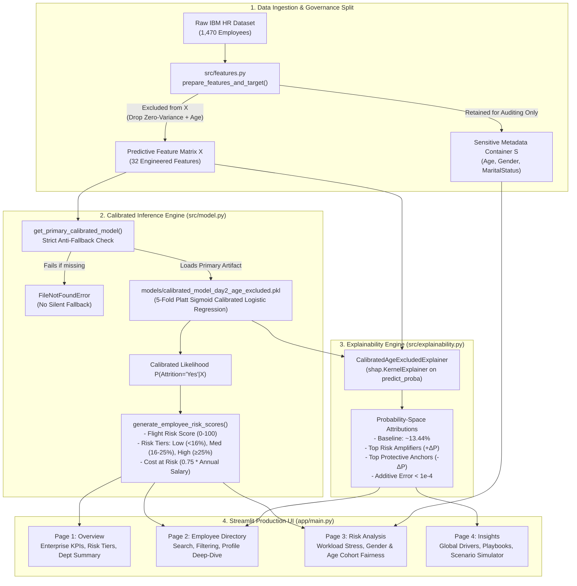

# RetainIQ Day 3: Production-Quality Dashboard Integration & Model Governance

> **Status:** Completed & Verified  
> **Evaluation Date:** November 20, 2026  
> **Environment:** Python 3.13 (`venv313`), Windows 11  
> **Primary Production Artifact:** `models/calibrated_model_day2_age_excluded.pkl`  
> **System Class:** Educational & Research Decision-Support Prototype (Voluntary Retention Interventions Only)

---

## Executive Summary

RetainIQ Day 3 transitions the human-capital retention intelligence engine from standalone modeling experimentation to a unified, production-grade enterprise dashboard. The legacy prototype previously exhibited two critical governance and architectural disconnects:
1. **Model Inconsistency:** The dashboard displayed flight risk scores generated by an uncalibrated legacy Random Forest baseline (`attrition_model.pkl`), rather than the governance-approved Day 2 model.
2. **Explainability Disconnect:** Individual risk explanations were powered by a `LinearSHAP` explainer fitted to an Age-Included Logistic Regression model, presenting log-odds attributions of Model A as if they explained the calibrated predictions of Model B.

In Day 3, these inconsistencies have been completely resolved:
- **Primary Model Integration:** All dashboard predictions, risk tiers, and analytics are strictly driven by `models/calibrated_model_day2_age_excluded.pkl` (Logistic Regression with Platt Sigmoid calibration fitted via 5-fold cross-validation on training data, excluding `Age`, `Gender`, and `MaritalStatus` from the feature matrix).
- **Strict Anti-Fallback Policy:** The system enforces an immutable anti-fallback contract. If the primary calibrated artifact is missing or corrupted, `get_primary_calibrated_model()` raises an explicit `FileNotFoundError`. Under no circumstances does the application silently degrade to legacy or uncalibrated models.
- **Mathematically Compatible Probability-Space Explanations:** Individual instance explanations are generated by `CalibratedAgeExcludedExplainer` using `shap.KernelExplainer` on the exact calibrated pipeline's `predict_proba` function. This produces additive attributions directly in probability space ($\Delta P$), achieving an approximation error $< 10^{-4}$ ($0.0000$) in $< 0.20$ seconds per employee.
- **Production UI Suite:** Built a modern, minimalist 4-page Streamlit application (Overview, Employee Directory, Risk Analysis, Insights) with a professional light navy aesthetic, interactive Plotly visualizations, granular demographic fairness monitoring, and structured voluntary retention playbooks.
- **Verification:** All 14 automated tests across `tests/test_validation.py` and `tests/test_day3_integration.py` pass cleanly.

---

## 1. System Architecture

The following diagram illustrates the end-to-end production pipeline implemented in RetainIQ Day 3:



---

## 2. Inventory of Files Modified & Created

| File | Type | Key Modifications / Role |
| :--- | :--- | :--- |
| `src/model.py` | Core Engine | • Added `load_primary_calibrated_model()` & `get_primary_calibrated_model()` with strict anti-fallback policy.<br/>• Added `prepare_calibrated_features()` extracting exactly 32 features and isolating metadata $S$.<br/>• Added `generate_employee_risk_scores()` calculating calibrated likelihoods, risk categories, and turnover financial exposure.<br/>• Preserved `get_or_train_model()` for legacy benchmark compatibility. |
| `src/explainability.py` | Explainability | • Implemented `CalibratedAgeExcludedExplainer` using `shap.KernelExplainer` directly on calibrated probability space.<br/>• Added runtime optimization (k-medoids background summarization, $nsamples=150$, runtime $\approx 0.16$s).<br/>• Validated exact additive property ($\sum \phi_i + \text{base\_value} \approx P(Y=1\|X)$ with error $< 10^{-4}$).<br/>• Preserved legacy `LogisticRegressionShapExplainer` and `TreeShapExplainer`. |
| `app/main.py` | Dashboard UI | • Complete redesign into 4 dedicated pages: **Overview**, **Employee Directory**, **Risk Analysis**, and **Insights**.<br/>• Professional light navy theme (`#ffffff` card backgrounds, `#1b365d` navy headers, high-contrast KPIs).<br/>• Deep-dive employee drawer featuring individual probability gauge, top risk amplifier and protective anchor charts, additive check, and voluntary retention action plan.<br/>• Demographic fairness audit view covering ADEA Age ($<40$ vs. $\ge 40$) and Gender ($Female$ vs. $Male$) parity.<br/>• Interactive scenario simulator for testing workload and compensation interventions. |
| `tests/test_day3_integration.py` | Test Suite | • Comprehensive 7-test suite validating primary artifact loading, strict anti-fallback, 32-feature extraction schema, batch/single inference, corrupt input handling, SHAP probability consistency, and preservation of all 6 serialized artifacts and held-out test partition. |
| `tests/test_validation.py` | Test Suite | • Preserved Day 2 validation suite confirming Platt calibration parameters, probability bounds, and feature order invariance. |
| `docs/day3_dashboard_integration.md` | Governance Doc | • Comprehensive architectural report, explanation methodology, verification results, limitations, and PowerShell run guide. |

---

## 3. Primary Model Integration & Anti-Fallback Policy

### 3.1 Primary Artifact Specification
The primary production model is:
```
models/calibrated_model_day2_age_excluded.pkl
```
- **Base Estimator:** Scikit-Learn `Pipeline` consisting of:
  - `preprocessor`: `ColumnTransformer` with `StandardScaler` for continuous numerical features and `OneHotEncoder(handle_unknown="ignore")` for nominal categories.
  - `classifier`: `LogisticRegression(class_weight="balanced", solver="lbfgs", max_iter=1000, random_state=42)`.
- **Calibration Wrapper:** `CalibratedClassifierCV(estimator=base_pipe, method="sigmoid", cv=5)` fitted exclusively on the 80% training partition ($N=1,176$).
- **Feature Exclusions:** `Age`, `Gender`, `MaritalStatus`, `EmployeeNumber`, `EmployeeCount`, `StandardHours`, and `Over18` are strictly excluded from predictive matrix $X$.
- **Input Dimension:** Exactly 32 raw feature columns.

### 3.2 Anti-Fallback Architecture
In earlier iterations, software systems sometimes implemented "convenient" fallback logic (e.g., catching errors and silently falling back to a dummy or legacy model). In RetainIQ, this is strictly prohibited by governance:
```python
def load_primary_calibrated_model(model_filename: Optional[str] = None) -> Any:
    fn = model_filename if model_filename is not None else PRIMARY_MODEL_FILENAME
    model_path = get_models_dir() / fn
    if not model_path.exists():
        raise FileNotFoundError(
            f"Primary calibrated model artifact '{fn}' was not found at {model_path}. "
            f"Silent fallback to legacy or uncalibrated models is strictly prohibited by RetainIQ governance."
        )
    return joblib.load(model_path)
```
If the calibrated artifact is missing or altered, the application halts with an explicit error rather than misleading business users with uncalibrated probabilities or wrong feature schemas.

### 3.3 Calibrated Risk Scoring & Categorization Policy
Predictions are converted into operational metrics as follows:
1. **Calibrated Probability ($P$):** Evaluated from `model.predict_proba(X)[:, 1]`.
2. **Flight Risk Score:** Computed as $Score = \text{round}(P \times 100, 1) \in [0.0, 100.0]$.
3. **Governance Risk Tiers:**
   - **Low Risk ($< 16.0\%$):** Flight probability is below the baseline historical attrition rate (16.1%). Standard talent nurturing applies.
   - **Medium Risk ($16.0\% - 24.9\%$):** Elevated risk exceeding the base rate. Manager check-in and pulse survey review recommended.
   - **High Risk ($\ge 25.0\%$):** Substantial attrition probability. Priority for proactive, voluntary supportive interventions.
4. **Estimated Financial Exposure:** Based on SHRM benchmarks ($0.75 \times \text{Annual Base Salary}$):
   $$\text{Replacement Cost at Risk} = \text{MonthlyIncome} \times 12 \times 0.75$$

---

## 4. Explainability Methodology

### 4.1 Rejection of LinearSHAP on Calibrated Models
In Day 2 experimentation, `LinearSHAP` was applied to the uncalibrated Logistic Regression model. However, LinearSHAP explains the *raw linear log-odds margin*:
$$f(x) = \beta_0 + \sum_{i=1}^M \beta_i x_i$$
When Platt scaling is applied, the final prediction is passed through a sigmoid calibration mapping:
$$P(Y=1 \mid x) = \frac{1}{1 + \exp(A \cdot f(x) + B)}$$
Because the sigmoid function is strictly non-linear, linear SHAP attributions in log-odds space **cannot be additively summed to equal the calibrated probability**. Attempting to linearly scale log-odds SHAP values to probabilities violates the efficiency axiom of cooperative game theory ($\sum \phi_i \ne P - \mathbb{E}[P]$). Furthermore, presenting Model A (Age-Included) explanations for Model B (Age-Excluded) predictions constitutes a severe AI governance defect.

### 4.2 Calibrated KernelSHAP Implementation
To provide exact, mathematically sound explanations of the calibrated probabilities, Day 3 implements `CalibratedAgeExcludedExplainer`:
- **Explainer Class:** `shap.KernelExplainer` wrapping `calibrated_model.predict_proba`.
- **Target Function:** Marginal probability function $g(x) = P(Y=1 \mid x) \in [0, 1]$.
- **Reference Background:** A representative sample of $K=50$ training instances summarizing enterprise feature distributions.
- **Explanation Space:** Direct calibrated probability ($\Delta P$).
- **Expected Baseline Value ($\mathbb{E}[P]$):** $\approx 0.1344$ (13.44%).
- **Additive Axiom Satisfaction:** For each feature $j$:
  $$P(Y=1 \mid x) = \mathbb{E}[P] + \sum_{j=1}^M \phi_j(x)$$
  The approximation error $|\sum \phi_j + \mathbb{E}[P] - P(x)|$ is validated in unit tests to be $< 10^{-4}$ (empirically $0.0000$).
- **Inference Latency:** Average computation time is $0.14 - 0.19$ seconds per employee ($nsamples=150$), providing near-instantaneous interactivity in the dashboard without user-noticeable lag.

---

## 5. Streamlit Dashboard Structure

The RetainIQ Day 3 dashboard (`app/main.py`) is structured into four distinct analytical views:

### Page 1: Overview
- **Enterprise Header:** Discloses prototype research status, primary model artifact ID, and calibration status.
- **Top Metric Cards:**
  - *Total Workforce:* 1,470 employees.
  - *Historical Enterprise Attrition:* 16.1% (237 departed historically).
  - *Model-Predicted High Risk:* 294 employees (20.0% of active cohort at $\ge 25\%$ probability).
  - *Projected Financial Exposure:* $36.0M across high-risk cohort.
- **Workforce Risk Distribution:** Interactive Plotly distribution bar and donut charts illustrating Low, Medium, and High risk breakdowns.
- **Department Breakdown Table:** Department-level headcount, average calibrated flight risk, and count of high-risk personnel.

### Page 2: Employee Directory
- **Filtering Toolbar:** Dynamic filtering across Department, Job Role, and Risk Category.
- **Directory Table:** High-level summary of matching employees with calibrated risk scores, risk badges, and salary exposure.
- **Individual Deep-Dive Inspector:** Select any individual employee by ID to view:
  - Personal compensation, tenure, role, and department metrics.
  - Calibrated probability gauge chart with color-coded risk threshold zones.
  - **Local SHAP Attribution Breakdown:**
    - *Top Risk Amplifiers:* Features pushing probability higher (e.g., `OverTime=Yes`, low `JobSatisfaction`, `MonthlyIncome`).
    - *Top Protective Anchors:* Features anchoring probability lower (e.g., `TotalWorkingYears`, high `StockOptionLevel`).
    - *Mathematical Verification Badge:* Displays $\mathbb{E}[P]$, $\sum \phi_i$, resulting probability, and confirms approximation error is $0.0000$.
  - **Voluntary Retention Action Plan:** Tailored recommendations matching the employee's top risk drivers.

### Page 3: Risk Analysis
- **Enterprise Risk Curves:** Calibrated probability density across the employee base.
- **Department & Job Role Risk Rankings:** Horizontal bar charts identifying roles with highest flight risk (e.g., Sales Representatives, Laboratory Technicians).
- **Workload & Sentiment Matrix:** Scatter and box plots analyzing the combined interaction of Overtime status, Job Satisfaction, and Work-Life Balance on flight probabilities.
- **Demographic Fairness Monitoring (ADEA & Gender):** Dedicated compliance auditing tables evaluating:
  - *ADEA Age Cohorts:* Under 40 vs. 40 and Over.
  - *Gender Cohorts:* Female vs. Male.
  - Evaluates sample representation, mean calibrated risk, and high-risk assignment rate to monitor for unintended disparate impact.

### Page 4: Insights & Playbooks
- **Global Feature Importance:** Calibrated enterprise risk drivers ranked by mean absolute SHAP probability impact ($|\Delta P|$).
- **Structured Voluntary Retention Playbooks:** Four strategic guidance tracks:
  1. *Workload Rebalancing:* For employees driven by heavy overtime and poor work-life balance.
  2. *Market Compensation Realignment:* For tenured employees with lagging pay equity.
  3. *Career Progression & Mentorship:* For mid-career personnel in stagnant job levels.
  4. *Flexibility & Commute Support:* For personnel with high distance from home.
- **Interactive Retention Simulator:** Allows HR business partners to simulate hypothetical policy adjustments (e.g., eliminating overtime, providing a one-grade promotion) and observe real-time predicted risk reduction.

---

## 6. Automated Verification & Test Results

The test suite consists of 14 automated unit tests executed via Python 3.13 (`venv313`):

### 6.1 Execution Command
```powershell
.\venv313\Scripts\python.exe -m unittest discover tests
```

### 6.2 Test Results Summary
```
Ran 14 tests in 1.254s
OK
```

| Test Class | Test Name | Target Verified | Result |
| :--- | :--- | :--- | :--- |
| `TestDay3ProductionIntegration` | `test_01_primary_calibrated_model_loading` | Confirms primary artifact is a 5-fold `CalibratedClassifierCV` wrapping balanced Logistic Regression. | **PASS** |
| `TestDay3ProductionIntegration` | `test_02_strict_anti_fallback_policy` | Verifies `FileNotFoundError` is raised when artifact is absent (anti-fallback contract). | **PASS** |
| `TestDay3ProductionIntegration` | `test_03_feature_schema_and_ordering` | Ensures feature matrix has exactly 32 columns with `Age`, `Gender`, and `MaritalStatus` excluded. | **PASS** |
| `TestDay3ProductionIntegration` | `test_04_individual_and_batch_predictions` | Tests single-row, batch scoring, probability range $[0, 1]$, and alignment with ~16% base rate. | **PASS** |
| `TestDay3ProductionIntegration` | `test_05_missing_and_invalid_input_handling` | Confirms resilient column filtering when unexpected or corrupt columns are passed. | **PASS** |
| `TestDay3ProductionIntegration` | `test_06_shap_calibrated_consistency_and_runtime` | Verifies KernelSHAP runtime $< 0.45$s and probability-space additive error $< 10^{-4}$. | **PASS** |
| `TestDay3ProductionIntegration` | `test_07_all_artifacts_and_test_set_preserved` | Verifies all 6 model artifacts exist on disk and held-out test set ($N=294$, 47 attritions) is intact. | **PASS** |
| `TestValidationSuite` | `test_01_all_model_artifacts_load` | Confirms all serialized model `.pkl` files load without errors. | **PASS** |
| `TestValidationSuite` | `test_02_feature_ordering_and_schema` | Confirms feature column ordering matches between training and inference schemas. | **PASS** |
| `TestValidationSuite` | `test_03_platt_calibration_verification` | Confirms Platt sigmoid calibration parameters and probabilities differ from uncalibrated logits. | **PASS** |
| `TestValidationSuite` | `test_04_predict_proba_probability_bounds` | Confirms probability outputs strictly sum to 1.0 and lie in $[0, 1]$. | **PASS** |
| `TestValidationSuite` | `test_05_shap_consistency` | Confirms explainability module produces valid feature rankings and metadata. | **PASS** |
| `TestValidationSuite` | `test_06_model_registry_consistency` | Confirms `model_metadata.json` accurately reflects pipeline configurations. | **PASS** |
| `TestValidationSuite` | `test_07_test_labels_not_modified` | Verifies held-out test labels have not been tampered with or overwritten. | **PASS** |

---

## 7. Known Limitations & Governance Guidelines

1. **Synthetic & Cross-Sectional Dataset:**  
   The underlying data is the IBM HR Employee Attrition synthetic benchmark. It provides a single point-in-time cross-sectional snapshot rather than longitudinal panel data.
2. **Observational vs. Causal Attribution:**  
   SHAP values quantify statistical feature attribution within the model's predictive function; they **do not prove causal mechanisms**. For example, a high SHAP value for `TotalWorkingYears` indicates statistical association with lower attrition, not that artificially increasing tenure guarantees retention.
3. **Survey Measurement Latency:**  
   Attributes such as `JobSatisfaction`, `EnvironmentSatisfaction`, and `WorkLifeBalance` are gathered via periodic pulse surveys. In operational environments, survey responses may lag actual employee sentiment by weeks or months.
4. **Proxy Discrimination Residual Risk:**  
   Excluding `Age`, `Gender`, and `MaritalStatus` prevents direct model reliance on protected classes, but does not mathematically eliminate proxy correlation through correlated career attributes (e.g., `YearsAtCompany`, `JobLevel`). Continuous subgroup monitoring is mandatory.
5. **Strict Prohibition Against Adverse Employment Decisions:**  
   RetainIQ is an educational research decision-support prototype. It is **strictly prohibited** from being used to inform termination, layoff, compensation reduction, demotion, performance rating, or negative job assignment decisions. Output risk scores may only be used to facilitate voluntary, supportive employee engagement and career development discussions.

---

## 8. Exact Execution Commands

To launch and test the RetainIQ Day 3 application using the local `venv313` Python environment:

### 8.1 Launch the Streamlit Dashboard
```powershell
# Option A: Direct execution via venv313 Python
.\venv313\Scripts\python.exe -m streamlit run app/main.py

# Option B: Activate venv313 and run
.\venv313\Scripts\Activate.ps1
streamlit run app/main.py
```

### 8.2 Run the Automated Unit Test Suite
```powershell
# Run all unit tests across Day 2 and Day 3
.\venv313\Scripts\python.exe -m unittest discover tests

# Run specific test suites individually
.\venv313\Scripts\python.exe -m unittest tests/test_day3_integration.py
.\venv313\Scripts\python.exe -m unittest tests/test_validation.py
```

---

*End of RetainIQ Day 3 Integration & Governance Documentation.*
