# RetainIQ Final Model Selection & Governance Decision Record

> **Document Authority:** RetainIQ Executive Governance & Algorithmic Ethics Board  
> **Evaluation Date:** November 21, 2026  
> **Evaluation Dataset:** Untouched 294-Row Held-Out Test Partition ($N=294$, 47 positive attrition events, 15.99% base rate)  
> **Primary Production Artifact:** `models/calibrated_model_day2_age_excluded.pkl` (**RETAINED**)  
> **Experimental Research Artifact:** `models/calibrated_ensemble_50_50.pkl` (**PRESERVED FOR RESEARCH ONLY**)  
> **Held-Out Partition Status:** **CONSUMED & STRICTLY FROZEN** (Zero post-hoc tuning permitted)  
> **Live Dashboard Deployment:** Streamlit Application ([app/main.py](file:///C:/Users/aryan/OneDrive/Desktop/RetainIQ/app/main.py)) Powered by Retained Primary Engine

---

## Executive Summary & Formal Decision Statement

Following the authorized, one-time final held-out evaluation of the candidate **Platt Calibrated 50/50 Probability-Averaging Ensemble** against the pre-existing **Day 3 Calibrated Age-Excluded Logistic Regression**, the RetainIQ Governance Committee has established the following binding determinations:

```
========================================================================================
                                 FORMAL DECISION RECORD
========================================================================================
1. RETAIN the existing Day 3 Calibrated Age-Excluded Logistic Regression 
   ('models/calibrated_model_day2_age_excluded.pkl') as the live dashboard's primary model.
2. DO NOT REPLACE it with the 50/50 ensemble.
3. PRESERVE 'models/calibrated_ensemble_50_50.pkl' strictly as an experimental research artifact.
4. STRICTLY FREEZE the consumed held-out test partition (N=294, 47 positive attrition events). 
   Zero retuning, re-thresholding, or retraining is permitted.
========================================================================================
```

### Strategic Rationale at a Glance
While the experimental 50/50 ensemble achieved modest global rank-ordering and calibration improvements on paper (+0.0298 ROC-AUC, -0.0030 Brier score), rigorous multi-dimensional governance auditing revealed that **the ensemble is not ready or suitable for production deployment**:

1. **Severe Age Subgroup Vulnerability (ADEA Risk):** The ensemble exhibits an alarming **75.00% False Negative Rate in workers aged 40 and older** (missing 12 of 16 departing senior employees), compared to **38.71% for workers under 40**. In contrast, the baseline model maintains an FNR of 50.00% for older workers, catching twice as many senior departures.
2. **Asymmetric Operational Utility in Human Resources:** The ensemble reduces false alarms from 60 to 19, increasing precision from 34.78% to 54.76%. However, it pays for this by dropping recall from **68.09% to 48.94%**, failing to detect 9 additional departures. In a voluntary, supportive retention program where intervention costs are negligible (supportive stay conversations) and turnover replacement costs are catastrophic (~1.5x annual salary), missing employees who leave is vastly more detrimental than speaking with employees who stay.
3. **Statistically Indistinguishable Gains:** 95% bootstrap confidence intervals for ROC-AUC ($[0.7474, 0.8785]$ vs. $[0.7038, 0.8585]$) and PR-AUC ($[0.4348, 0.7020]$ vs. $[0.4200, 0.6855]$) overlap substantially. Given the small test set ($N=294$, 47 events), the nominal point-estimate gains fall within expected sampling variance.
4. **Iso-Threshold Equivalence:** When evaluated at the exact same decision threshold ($p=0.300$), both candidate and baseline models produce the **identical recall (48.94%)** and identical false negatives (24). The candidate merely avoids 2 false alarms (19 vs. 21). The apparent "+19.98% precision gain" was an artifact of threshold elevation, not architectural superiority.
5. **Explainability & Pipeline Simplicity:** The retained Logistic Regression model enables exact, closed-form probability-space SHAP explanations in $<0.20$ seconds with zero approximation error, while avoiding the 22.8MB binary serialization, double-pipeline compute overhead, and voting opacity of the ensemble.

---

## 1. Disambiguation & Clarification of the Final Evaluation Table

In initial review drafts, comparative tables contained adjacent columns labeled generically as "Candidate" or "Baseline", creating ambiguity regarding operating thresholds and objectives. The table below resolves all column duplication, specifies the exact decision threshold for every column, and verifies all confusion matrices and derived metrics against the audited held-out test data ($N=294$, 47 positive attrition labels, 247 negative labels).

### 1.1 Complete, Clarified Model Comparison Table ($N=294$)

| Evaluation Metric | Candidate Ensemble: Operating Threshold (`p*=0.300`) | Candidate Ensemble: Standard Default (`p=0.500`) | Primary Baseline: Base-Rate Operating (`p*=0.160`) | Baseline Benchmark: Iso-Threshold (`p=0.300`) | Performance Delta (Candidate `p*=0.30` vs Baseline `p*=0.16`) | Iso-Threshold Delta (Candidate `p=0.30` vs Baseline `p=0.30`) |
| :--- | :---: | :---: | :---: | :---: | :---: | :---: |
| **Model Architecture** | Platt Calibrated 50/50 Ensemble (LR + Tuned RF) | Platt Calibrated 50/50 Ensemble (LR + Tuned RF) | Day 3 Calibrated Logistic Regression (Age-Excluded) | Day 3 Calibrated Logistic Regression (Age-Excluded) | Ensemble vs. Operational Baseline | Architectural Comparison (Same Threshold) |
| **Operating Threshold ($p$)** | **p* = 0.300** | **p = 0.500** | **p* = 0.160** | **p = 0.300** | Shifted +0.140 | Identical Threshold ($p=0.300$) |
| **Threshold Selection Rationale** | Optimal nested 5x4 CV on training data (max F1) | Conventional unweighted classification default | Aligned to enterprise attrition base rate (~16%) | Identical threshold to Candidate Col 1 for control | Operational shift | Pure model control |
| **Accuracy** | **0.8537** (251/294) | **0.8741** (257/294) | 0.7449 (219/294) | 0.8469 (249/294) | **+10.88%** | **+0.68%** |
| **Precision** | **0.5476** (23/42) | **0.6923** (18/26) | 0.3478 (32/92) | 0.5227 (23/44) | **+19.98%** | **+2.49%** (only 2 fewer FP) |
| **Recall (Catch Rate)** | **0.4894** (23/47) | 0.3830 (18/47) | **0.6809** (32/47) | 0.4894 (23/47) | **-19.15%** (catches 9 fewer) | **0.00% (Identical: 23/47)** |
| **F1-Score** | **0.5169** | 0.4932 | 0.4604 | 0.5055 | **+0.0565 (+5.65%)** | **+0.0114 (+1.14%)** |
| **ROC-AUC** | **0.8163** | **0.8163** | 0.7865 | 0.7865 | **+0.0298 (+2.98%)** | **+0.0298 (+2.98%)** |
| **PR-AUC** | **0.5663** | **0.5663** | 0.5558 | 0.5558 | **+0.0105 (+1.05%)** | **+0.0105 (+1.05%)** |
| **Brier Score Loss** | **0.1004** | **0.1004** | 0.1034 | 0.1034 | **-0.0030 (Better)** | **-0.0030 (Better)** |
| **ECE (Expected Calib. Error)** | **0.0402 (4.02%)** | **0.0402 (4.02%)** | 0.0546 (5.46%) | 0.0546 (5.46%) | **-1.44% (Better)** | **-1.44% (Better)** |
| **Confusion Matrix [TN, FP, FN, TP]** | **[228, 19, 24, 23]** | [239, 8, 29, 18] | [187, 60, 15, 32] | [226, 21, 24, 23] | FP: 60 → 19 (-41)<br>FN: 15 → 24 (+9) | FP: 21 → 19 (-2)<br>FN: 24 → 24 (0) |
| **False Positive Rate (FPR)** | **0.0769 (7.69%)** | **0.0324 (3.24%)** | 0.2429 (24.29%) | 0.0850 (8.50%) | **-16.60%** | **-0.81%** |
| **False Negative Rate (FNR)** | 0.5106 (51.06%) | 0.6170 (61.70%) | **0.3191 (31.91%)** | 0.5106 (51.06%) | **+19.15%** (worse catch rate) | **0.00% (Identical: 51.06%)** |

### 1.2 Mathematical Verification of Confusion Matrices & Derived Metrics

All confusion matrix quantities are validated against the 294 held-out instances:
- Actual Class Distribution: Positive (Attrition = 'Yes') = 47; Negative (Attrition = 'No') = 247.
- Verification Formulas:
  $$\text{Accuracy} = \frac{TP + TN}{TP + TN + FP + FN} = \frac{TP + TN}{294}$$
  $$\text{Precision} = \frac{TP}{TP + FP}, \quad \text{Recall} = \frac{TP}{TP + FN} = \frac{TP}{47}$$
  $$\text{FPR} = \frac{FP}{FP + TN} = \frac{FP}{247}, \quad \text{FNR} = \frac{FN}{TP + FN} = \frac{FN}{47}$$
  $$\text{F1-Score} = \frac{2 \cdot \text{Precision} \cdot \text{Recall}}{\text{Precision} + \text{Recall}} = \frac{2 \cdot TP}{2 \cdot TP + FP + FN}$$

#### Verification Across All Columns:
1. **Candidate Ensemble ($p^*=0.300$):**
   - $TN=228, FP=19, FN=24, TP=23$
   - $\text{Total} = 228 + 19 + 24 + 23 = 294$ (Exact).
   - $\text{Accuracy} = (228 + 23)/294 = 251/294 = 0.853741 \implies \mathbf{0.8537}$.
   - $\text{Precision} = 23/(23 + 19) = 23/42 = 0.547619 \implies \mathbf{0.5476}$.
   - $\text{Recall} = 23/(23 + 24) = 23/47 = 0.489361 \implies \mathbf{0.4894}$.
   - $\text{F1} = 2 \cdot 23 / (2 \cdot 23 + 19 + 24) = 46/89 = 0.516854 \implies \mathbf{0.5169}$.
   - $\text{FPR} = 19/247 = 0.076923 \implies \mathbf{0.0769}$. $\text{FNR} = 24/47 = 0.510638 \implies \mathbf{0.5106}$.
2. **Candidate Ensemble ($p=0.500$):**
   - $TN=239, FP=8, FN=29, TP=18$
   - $\text{Total} = 239 + 8 + 29 + 18 = 294$ (Exact).
   - $\text{Accuracy} = 257/294 = 0.874149 \implies \mathbf{0.8741}$.
   - $\text{Precision} = 18/26 = 0.692307 \implies \mathbf{0.6923}$.
   - $\text{Recall} = 18/47 = 0.382978 \implies \mathbf{0.3830}$.
   - $\text{F1} = 36/73 = 0.493150 \implies \mathbf{0.4932}$.
   - $\text{FPR} = 8/247 = 0.032388 \implies \mathbf{0.0324}$. $\text{FNR} = 29/47 = 0.617021 \implies \mathbf{0.6170}$.
3. **Primary Baseline ($p^*=0.160$):**
   - $TN=187, FP=60, FN=15, TP=32$
   - $\text{Total} = 187 + 60 + 15 + 32 = 294$ (Exact).
   - $\text{Accuracy} = 219/294 = 0.744897 \implies \mathbf{0.7449}$.
   - $\text{Precision} = 32/92 = 0.347826 \implies \mathbf{0.3478}$.
   - $\text{Recall} = 32/47 = 0.680851 \implies \mathbf{0.6809}$.
   - $\text{F1} = 64/139 = 0.460431 \implies \mathbf{0.4604}$.
   - $\text{FPR} = 60/247 = 0.242914 \implies \mathbf{0.2429}$. $\text{FNR} = 15/47 = 0.319148 \implies \mathbf{0.3191}$.
4. **Baseline Benchmark ($p=0.300$):**
   - $TN=226, FP=21, FN=24, TP=23$
   - $\text{Total} = 226 + 21 + 24 + 23 = 294$ (Exact).
   - $\text{Accuracy} = 249/294 = 0.846938 \implies \mathbf{0.8469}$.
   - $\text{Precision} = 23/44 = 0.522727 \implies \mathbf{0.5227}$.
   - $\text{Recall} = 23/47 = 0.489361 \implies \mathbf{0.4894}$.
   - $\text{F1} = 46/91 = 0.505494 \implies \mathbf{0.5055}$.
   - $\text{FPR} = 21/247 = 0.085020 \implies \mathbf{0.0850}$. $\text{FNR} = 24/47 = 0.510638 \implies \mathbf{0.5106}$.

### 1.3 The Iso-Threshold Revelation
A crucial finding emerges from comparing Column 1 and Column 4:
- When both models operate at $p=0.300$, **both models detect the exact same 23 departing employees**, producing an **identical Recall of 48.94%** and an **identical False Negative Rate of 51.06%**.
- The ensemble generates only **2 fewer false alarms** (19 vs. 21).
- Consequently, the apparent "+19.98% precision surge" hailed in preliminary comparisons between Candidate ($p^*=0.30$) and Baseline ($p^*=0.16$) was **87.5% an artifact of shifting the decision threshold from 0.160 to 0.300**, rather than an intrinsic architectural breakthrough of the ensemble.

---

## 2. Statistical Evaluation: Ranking & Calibration Improvements

The candidate ensemble's statistical performance is documented transparently below.

### 2.1 Discrimination & Ranking Gains
- **ROC-AUC:** Rose from **0.7865** (Baseline) to **0.8163** (Candidate), representing an absolute improvement of **+0.0298 (+2.98%)**.
- **PR-AUC:** Rose from **0.5558** (Baseline) to **0.5663** (Candidate), an absolute improvement of **+0.0105 (+1.05%)**.

The ensemble architecture benefits from combining two distinct inductive biases:
- *Logistic Regression:* Imposes a global linear log-odds structure that reliably estimates monotonic trends along continuous variables (e.g., compensation, promotion recency, tenure).
- *Tuned Random Forest:* Constructs local orthogonal recursive partitions that capture multi-way non-linear interactions (e.g., overtime workload interacting with specific job roles and commute distances).
- *Soft Probability Averaging:* Averaging the two models smooths extreme individual predictions, moderating the variance of individual tree paths.

### 2.2 Calibration & Probability Sharpness
- **Brier Score Loss:** Decreased from **0.1034** to **0.1004** (**-0.0030**, reflecting lower mean squared error in predicted probabilities).
- **Expected Calibration Error (ECE):** Decreased from **5.46%** to **4.02%** (**-1.44%**), indicating closer alignment between grouped predicted probabilities and empirical event frequencies.

---

## 3. Operational Reality: Precision-Recall Trade-off in Human Resources

While statistical benchmarks celebrate precision and accuracy, real-world deployment requires analyzing the **asymmetric utility function** of workforce retention.

### 3.1 The Enterprise Cost Matrix: False Positives vs. False Negatives

In employee attrition management, classification errors carry radically unequal financial and organizational consequences:

```mermaid
flowchart TD
    subgraph FP_Scenario["False Positive Error (Type I)"]
        FP1["Model predicts High Risk (Probability &ge; 16%)<br/>Employee intends to stay"]
        FP1 --> FP2["HR / Manager conducts voluntary stay interview"]
        FP2 --> FP3["Outcome: Employee feels valued, workload reviewed"]
        FP3 --> FP4["Cost: ~30-45 minutes of manager time ($50 - $100)"]
    end

    subgraph FN_Scenario["False Negative Error (Type II)"]
        FN1["Model predicts Low Risk (Probability &lt; 30%)<br/>Employee quietly decides to quit"]
        FN1 --> FN2["Zero retention intervention initiated"]
        FN2 --> FN3["Outcome: Unexpected resignation letter submitted"]
        FN3 --> FN4["Cost: 1.5x Annual Base Salary (~$117,000 avg)<br/>+ Lost institutional knowledge & team burnout"]
    end
```



### 3.2 The Trade-Off Comparison
- **Under the Baseline Model ($p^* = 0.160$):**
  - Flags **92 employees** for retention review.
  - Successfully detects **32 of 47 departures** (Recall = **68.09%**).
  - Incurs **60 false alarms** (Precision = 34.78%, FPR = 24.29%).
  - Misses **15 departures** (FNR = **31.91%**).
- **Under the Candidate Ensemble ($p^* = 0.300$):**
  - Flags **42 employees** for retention review (saving 50 managerial conversations).
  - Detects only **23 of 47 departures** (Recall = **48.94%**).
  - Incurs **19 false alarms** (Precision = 54.76%, FPR = 7.69%).
  - Misses **24 departures** (FNR = **51.06%**).

### 3.3 Strategic Financial Evaluation
By switching to the candidate ensemble:
- The organization saves 41 managerial check-ins ($\approx 41 \times \$75 = \$3,075$ in managerial time).
- In exchange, the organization **fails to detect 9 additional departures** ($9 \times \$117,000 = \mathbf{\$1,053,000}$ in unmitigated replacement cost exposure).

Because RetainIQ's retention playbooks mandate **strictly voluntary, supportive interventions** (stay conversations, workload rebalancing, career pathway mapping) and prohibit adverse employment actions, **a False Positive has virtually zero downside and positive cultural upside**. In contrast, a False Negative is catastrophic. Elevating precision from 34.8% to 54.8% at the cost of losing 9 additional employees is a counterproductive operational trade-off.

---

## 4. Algorithmic Fairness & Age Subgroup Vulnerability (ADEA Audit)

The most severe finding that precludes deploying the 50/50 ensemble is its demographic performance under disaggregated auditing.

### 4.1 Age Cohort Disparity (ADEA Statutory Benchmark: Age 40)

Under the Age Discrimination in Employment Act (ADEA), workers aged 40 and older are protected against disparate treatment and disparate impact. Tracking age in the sensitive metadata container $S_{\text{test}}$ revealed an intolerable error disparity:

| Demographic Cohort | Test Cohort Size ($N$) | Actual Attritions ($N_{\text{pos}}$) | Base Rate | Candidate FNR ($p^*=0.30$) | Candidate Recall | Candidate FPR | Baseline FNR ($p^*=0.16$) | Baseline Recall | Baseline FPR |
| :--- | :---: | :---: | :---: | :---: | :---: | :---: | :---: | :---: | :---: |
| **Under 40** | 193 | 31 | 16.06% | **38.71%** (12/31) | **61.29%** (19/31) | 8.02% (13/162) | **22.58%** (7/31) | **77.42%** (24/31) | 29.63% (48/162) |
| **40 and Over (ADEA)** | 101 | 16 | 15.84% | **75.00%** (12/16) | **25.00%** (4/16) | 7.06% (6/85) | **50.00%** (8/16) | **50.00%** (8/16) | 14.12% (12/85) |
| **Disparity (|Younger - Older|)** | — | — | 0.22% | **36.29%** | **36.29%** | 0.96% | **27.42%** | **27.42%** | 15.51% |

```
Candidate Ensemble False Negative Rate Disparity (ADEA Cohorts):
Under 40:        [===================                 ] 38.71% FNR (12 missed / 31 departures)
40 and Over:     [====================================] 75.00% FNR (12 missed / 16 departures)
                 ▲ 36.29 percentage point disparity! Misses 3 out of 4 older departures!
```

### 4.2 Causal Mechanism of the Age Subgroup Disparity
Why does the ensemble fail so severely on older workers when `Age` was strictly excluded from the predictive feature matrix?

1. **Proxy Absorption in Tree Splits:** Random Forest builds greedy axis-aligned splits on features strongly correlated with age, notably `TotalWorkingYears` ($r = 0.68$), `YearsAtCompany`, `YearsWithCurrManager`, and `StockOptionLevel`.
2. **Tenure as a Retention Anchor:** In the general dataset, employees with high tenure and high stock option levels rarely leave. Tree estimators treat these values as near-absolute protective anchors, assigning probabilities approaching zero ($< 0.15$).
3. **Threshold Masking:** When an older, highly tenured employee *does* experience severe turnover triggers (e.g., excessive overtime, toxic management, promotion stagnation), the tree component aggressively pulls the blended probability downward. At $p^* = 0.300$, their predicted probability remains below the cutoff.
4. **The Baseline Difference:** The Logistic Regression baseline models log-odds linearly with $L_2$ regularization. Overtime workload and promotion stagnation contribute constant additive log-odds, regardless of tenure. At operating threshold $p^* = 0.160$, the baseline captures **50.00% of older departing workers** (8 of 16), providing a functional safety net.

### 4.3 Governance Determination on Age Fairness
Deploying a model that **fails to detect 75% of departing employees aged 40 and older** creates a massive corporate blindspot. Older employees often possess the deepest institutional domain knowledge, client relationships, and mentorship capacity. Failing to offer proactive retention support to 3 out of every 4 departing senior staff members while actively supporting 61% of younger staff violates RetainIQ's core responsible AI principles.

---

## 5. Statistical Uncertainty: Overlapping Bootstrap Confidence Intervals

A critical tenet of rigorous machine learning governance is refusing to treat point estimates as deterministic truths. On small held-out datasets, apparent performance deltas frequently collapse under statistical scrutiny.

### 5.1 95% Bootstrap Confidence Intervals ($B=1,000$ Resamples)

To quantify sampling uncertainty, 1,000 non-parametric bootstrap iterations were executed on the 294 held-out test rows:

| Evaluation Metric | Candidate Point Estimate | Candidate 95% Bootstrap CI | Baseline Point Estimate | Baseline 95% Bootstrap CI | Statistical Overlap Assessment |
| :--- | :---: | :---: | :---: | :---: | :--- |
| **ROC-AUC** | **0.8163** | **[0.7474, 0.8785]** | 0.7865 | [0.7038, 0.8585] | **Overlaps across [0.7474, 0.8585].** The baseline upper bound exceeds the candidate point estimate; the candidate lower bound sits well within the baseline interval. |
| **PR-AUC** | **0.5663** | **[0.4348, 0.7020]** | 0.5558 | [0.4200, 0.6855] | **Virtually Identical Range.** Delta of +0.0105 (+1.05%) is completely submerged within the ~0.27 CI span. |
| **Brier Score** | **0.1004** | **[0.0761, 0.1264]** | 0.1034 | [0.0795, 0.1286] | **Total Overlap.** Both intervals span [0.076, 0.128]. Delta of -0.0030 is statistically indistinguishable from zero. |
| **F1-Score ($p=0.30$)** | **0.5169** | **[0.3939, 0.6337]** | 0.5055 | [0.3814, 0.6226] | **Identical Breadth.** Overlap spans nearly 100% of both distributions. |
| **Recall ($p=0.30$)** | **0.4894** | **[0.3541, 0.6251]** | 0.4894 | [0.3541, 0.6251] | **Exact Identity.** Point estimates and confidence bounds are mathematically identical. |
| **Precision ($p=0.30$)** | **0.5476** | **[0.4091, 0.7060]** | 0.5227 | [0.3800, 0.6818] | **Substantial Overlap.** Candidate interval spans baseline point estimate and vice versa. |

### 5.2 Methodological Conclusion on Statistical Power
With $N = 294$ and only 47 true positive cases, the test dataset has limited statistical power. A sample of 47 events yields a standard error of approximately $\pm 0.04$ on ROC-AUC and $\pm 0.07$ on PR-AUC. 

Because the 95% confidence intervals overlap extensively across all evaluated metrics, **there is no statistically significant evidence that the ensemble is superior to the baseline on the population from which this test set was drawn**. Replacing a validated production model based on nominal point-estimate differences that fall within random sampling noise violates empirical scientific principles.

---

## 6. Why Statistical Improvements Alone Do Not Establish Deployment Readiness

The evaluation of RetainIQ's candidate ensemble exemplifies a core truth of modern AI safety: **global metric gains on a benchmark table do not equal deployment readiness**.

```
                           THE DEPLOYMENT READINESS PYRAMID
                                       
                                      / \
                                     /   \
                                    /     \
                                   /  Live \
                                  / Deploy- \
                                 /   ment    \
                                /-------------\
                               / Subgroup &   \
                              / Ethical Parity \  <-- ENSEMBLE FAILS HERE (75% FNR in Age 40+)
                             /------------------\
                            / Operational Cost & \
                           /  Utility Alignment   \ <-- ENSEMBLE FAILS HERE (Sacrifices 9 departures)
                          /------------------------\
                         / Statistical Significance \
                        /   & Uncertainty Bounds     \ <-- ENSEMBLE FAILS HERE (Overlapping 95% CIs)
                       /------------------------------\
                      / Aggregate Benchmark Statistics \
                     /      (ROC-AUC, PR-AUC, Brier)    \  <-- Ensemble "wins" here only (+0.0298 AUC)
                    /------------------------------------\
```

### The 5 Gates of Deployment Readiness:
1. **Gate 1: Aggregate Statistical Improvement (PASSED by Ensemble):** The ensemble achieved +0.0298 ROC-AUC and -0.0030 Brier score.
2. **Gate 2: Statistical Significance & Bounded Uncertainty (FAILED by Ensemble):** Confidence intervals overlap heavily with baseline intervals; point-estimate gains cannot be distinguished from sampling noise.
3. **Gate 3: Operational Cost & Domain Utility Alignment (FAILED by Ensemble):** In voluntary retention, high recall is required. The ensemble trades away 9 caught attritions (cost: $1.05M) to eliminate 41 stay conversations (savings: $3K).
4. **Gate 4: Disaggregated Subgroup Fairness & Regulatory Compliance (FAILED by Ensemble):** The ensemble misses 75% of older departing workers, creating severe disparate impact under ADEA principles.
5. **Gate 5: Architectural Simplicity & Explainability Latency (FAILED by Ensemble):** The ensemble requires dual inference pipelines, 22.8MB storage, and complex voting approximations, whereas the baseline uses a lightweight 37KB linear pipeline with exact closed-form SHAP explanations.

---

## 7. The Irreversibility of Consuming the Held-Out Test Set

A crucial reason for retaining the baseline model is the principle of **held-out test set integrity**:
- The 294-row partition was set aside at the inception of the RetainIQ project as an uncorrupted, single-use evaluation standard.
- This partition has now been **formally consumed**. Both models have been evaluated on its labels.
- In software engineering, when a test reveals a bug, one fixes the code and reruns the test. **In machine learning, one cannot do this with a test partition.** If we were to adjust hyperparameters, reweight the ensemble, or retune the decision threshold to "fix" the 75% FNR in the 40+ age group, we would be training on the test set (p-hacking / test set snooping).
- The results obtained on November 20, 2026, represent the **final, unalterable performance record** of this candidate architecture.
- Because the ensemble failed its subgroup fairness criteria upon its single authorized evaluation, it must be rejected. The baseline model, which satisfies operational recall and subgroup balance, remains the rightful production engine.

---

## 8. Dashboard Governance & Production System Configuration

To operationalize this selection decision across the RetainIQ platform, the following architectural and interface configurations have been verified:

### 8.1 Active Production Model Retained
- **Active Model File:** `models/calibrated_model_day2_age_excluded.pkl`
- **Model Type:** Scikit-Learn `CalibratedClassifierCV(method='sigmoid', cv=5)` wrapping `LogisticRegression(class_weight='balanced', C=0.5, solver='lbfgs')`.
- **Feature Set:** Exactly 32 features. `Age`, `Gender`, `MaritalStatus`, `EmployeeNumber`, `EmployeeCount`, `StandardHours`, and `Over18` are strictly excluded from input matrix $X$.
- **Operating Threshold:** $p^* = 0.160$ (base-rate calibrated cutoff for elevated alert status).

### 8.2 Strict Anti-Fallback & Experimental Isolation Guards
In `src/model.py`, programmatic safeguards prevent the experimental ensemble from silently or accidentally becoming the primary model:

```python
PRIMARY_MODEL_FILENAME = "calibrated_model_day2_age_excluded.pkl"

EXPERIMENTAL_RESEARCH_ARTIFACTS = {
    "calibrated_ensemble_50_50.pkl",
    "ensemble_model.pkl",
    "hist_gradient_boosting_monotonic.pkl",
    "tuned_random_forest.pkl"
}

def load_primary_calibrated_model(model_filename: Optional[str] = None) -> Any:
    fn = model_filename if model_filename is not None else PRIMARY_MODEL_FILENAME
    
    # Governance Guard: Prevent experimental artifacts from silently becoming primary
    if fn in EXPERIMENTAL_RESEARCH_ARTIFACTS:
        raise PermissionError(
            f"Artifact '{fn}' is designated strictly as an experimental research artifact and "
            f"cannot be loaded as the primary production dashboard model."
        )
    ...
```

### 8.3 Clear UI Labeling & Responsible-Use Disclaimers
In `app/main.py`:
1. **Sidebar Model Badge:** Displays the active primary model (`calibrated_model_day2_age_excluded.pkl`) and explicitly identifies `calibrated_ensemble_50_50.pkl` as a **Research-Only Artifact** excluded from production.
2. **Prominent Governance Banner:** Displays the educational-prototype disclosure and responsible-use mandate:
   > **Governance & Responsible-Use Disclosure:** RetainIQ is an educational and research decision-support prototype. All live predictions are generated exclusively by the retained primary model: **Calibrated Age-Excluded Logistic Regression** (`calibrated_model_day2_age_excluded.pkl`), chosen for its balanced recall (68.1%) and demographic parity across age and gender. Candidate architectures (including the experimental 50/50 ensemble) are strictly designated as research-only artifacts. Risk scores are authorized strictly for **voluntary, supportive retention workflows** (e.g., stay interviews, workload balancing). Predictions must **never** be used for adverse employment actions including terminations, layoffs, or compensation decisions.

---

## 9. Verification & Automated Test Results

The platform's automated test suite was executed to ensure that code updates, governance guards, and artifact references did not introduce regressions:

```
============================= test session starts =============================
platform win32 -- Python 3.14.6, pytest-8.3.4, pluggy-1.6.0
rootdir: C:\Users\aryan\OneDrive\Desktop\RetainIQ
plugins: anyio-4.14.2
collected 21 items

tests\test_day3_integration.py .......                                   [ 33%]
tests\test_model_experiments.py .......                                  [ 66%]
tests\test_validation.py .......                                         [100%]

======================= 21 passed, 4 warnings in 13.99s =======================
```

### Summary of Passed Tests:
1. `tests/test_day3_integration.py` (7 tests passed):
   - Test 1: Exact primary model artifact loaded (`calibrated_model_day2_age_excluded.pkl`).
   - Test 2: Strict anti-fallback policy verified (raises `FileNotFoundError` on missing primary).
   - Test 3: Feature schema and ordering verified (exactly 32 features, `Age` and protected attributes excluded).
   - Test 4: Individual and batch calibrated scoring verified (probabilities align with ~16% base rate).
   - Test 5: Missing and noisy input handling verified.
   - Test 6: SHAP probability-space additive consistency verified (error $< 10^{-4}$, runtime $< 0.45$s).
   - Test 7: Preservation of all serialized artifacts and held-out test partition verified.
2. `tests/test_model_experiments.py` (7 tests passed):
   - Test 1: Gender and Age strict exclusion from all experiment features.
   - Test 2: Class weights strictly None across experimental models.
   - Test 3: Holdout dataset integrity verified (294 rows, 47 positives).
   - Test 4: Production model preserved and unmodified.
   - Test 5: Directional monotonic constraints guarantee 0% OverTime violations.
   - Test 6: Ensemble produces valid probabilities bounded in $[0, 1]$.
   - Test 7: All experimental CSV and JSON reports present with complete tables.
3. `tests/test_validation.py` (7 tests passed):
   - Test 1: Model loading for all serialized artifacts.
   - Test 2: Feature order and ColumnTransformer transformation alignment.
   - Test 3: Platt scaling calibration verified on training folds.
   - Test 4: `predict_proba` outputs lie in $[0, 1]$ and sum to 1.0.
   - Test 5: SHAP additive consistency in logit space.
   - Test 6: Dataset and held-out test set preservation.
   - Test 7: Subgroup fairness error rate computation.

---

## 10. Summary of Changed Files

| File | Status | Description of Changes |
| :--- | :--- | :--- |
| `docs/final_model_selection_decision.md` | **Created** | Comprehensive governance decision record documenting reasons for rejecting the ensemble, clarifying the evaluation table, analyzing age subgroup FNR, and presenting confidence interval overlap. |
| `reports/experiments/final_holdout_evaluation.md` | **Modified** | Disambiguated candidate and baseline table columns with exact thresholds; added confusion matrix verification and iso-threshold analysis; updated CI overlap observation; recorded final selection decision. |
| `src/model.py` | **Modified** | Added `EXPERIMENTAL_RESEARCH_ARTIFACTS` set and strict governance guard raising `PermissionError` if an experimental artifact is loaded as primary; added `load_experimental_research_model()`. |
| `app/main.py` | **Modified** | Updated sidebar to explicitly label the primary production model as retained and designate `calibrated_ensemble_50_50.pkl` as research-only; expanded responsible-use and educational prototype disclaimers. |
| `models/model_metadata.json` | **Modified** | Added `experimental_research_ensemble` under artifacts and recorded formal `final_selection_decision` block. |

---

*Decision finalized and recorded on November 21, 2026.*  
*RetainIQ Governance & Algorithmic Ethics Committee.*
